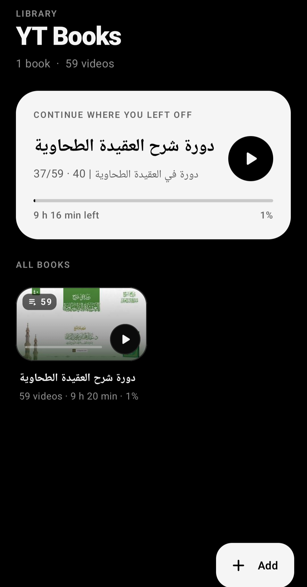
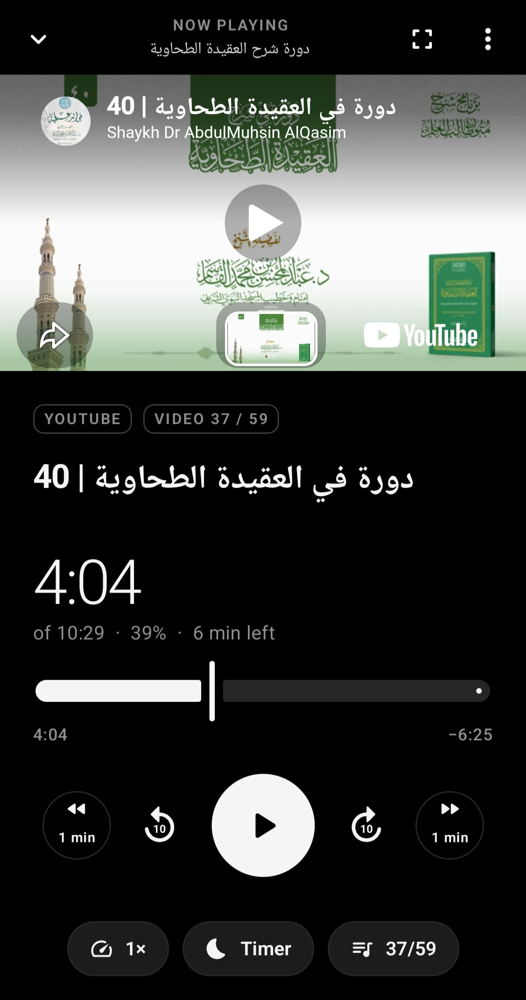

# YT Books

**Listen to YouTube playlists like audiobooks: focused, distraction-free, and always from where you left off.**

YT Books turns any YouTube playlist into a "book". Lectures, courses, podcasts: you add the playlist once, and the app keeps your place in every video. There are no recommendations, no comments, no Shorts, no autoplay into unrelated videos and no endless feed. Only the playlist you chose, in order.

> **Download:** [Latest release (APK)](https://github.com/amarhusika/yt-books/releases/download/v1.0/ytBookPlayer.apk)

---

## Screenshots

<p align="center">
  
  &nbsp;&nbsp;
  
</p>
<p align="center"><sub><b>Library</b>: every playlist is a book &nbsp;·&nbsp; <b>Player</b>: video on top, audiobook-style controls below</sub></p>

---

## Why

YouTube holds a huge amount of knowledge, but the YouTube app is built to keep you watching *something*, not to help you finish *what you started*. Open it to continue lecture 14 of a course and you are one tap away from a recommended video, a Short, or a rabbit hole.

YT Books is built around **knowledge and focus**:

- **One goal per session:** continue the playlist you picked.
- **Nothing pulling at your attention:** no home feed, no suggestions, no related videos, no comments.
- **Progress you can see:** how far you are in each video and in the whole playlist, and how much time is left.
- **Made for listening:** big, simple controls, speed control and a sleep timer, the same way an audiobook player works.

---

## Features

- **Add by link:** paste a playlist link, or share it straight from the YouTube app (*Share → YT Books*). A single video link works too.
- **Every playlist is a book,** with a cover, video count, total length and progress.
- **Remembers your position** in every video, per playlist.
- **Continue where you left off:** a card on the home screen takes you straight back.
- **Smart rewind:** after a pause it goes back 5 s (short pause) or 10 s (longer pause), so you don't lose the thread.
- **Autoplay next:** when a video ends, the next one *from the same playlist* starts. Never a recommendation.
- **Playback speed** from 0.25× to 2× (what YouTube's player allows), remembered per video.
- **Skip** ±10 s and ±1 min, and double-tap left or right on the video to skip ±10 s.
- **Sleep timer** with a gentle fade-out.
- **Video quality:** Auto by default, or choose 1080p–144p (⋮ → *Video quality*).
- **Check for new videos:** pulls new uploads from the playlist and keeps your progress.
- **Mark as watched / start over** for a single video or a whole book.
- **Remove a book:** long-press it in the library, or use the trash icon (asks for confirmation first).
- **Light and dark theme** that follows the system. Black, gray, white and whitesmoke palette.
- **Fullscreen landscape mode** with fade-away controls.

---

## How to use (for everyone)

1. **Install** the APK from the release link above. You may need to allow "Install unknown apps" for your browser or file manager.
2. **Copy a playlist link** in YouTube (*Share → Copy link*), for example:
   `https://www.youtube.com/playlist?list=PLxxxxxxxxxxxxxxxxxxxxxxxx`
3. Open YT Books, tap **Add** and paste the link. The app often fills it in from your clipboard for you.
   Shortcut: in the YouTube app tap **Share → YT Books** and the playlist is added straight away.
4. Tap the book and press **Play** or **Continue**.
5. That's it. Close the app any time and next time you continue from the exact spot.

**Good to know**

- The screen stays on while a video plays. When you leave the app or lock the screen, playback pauses and your position is saved. YouTube's player does not play in the background.
- To save battery and mobile data while you only listen, set a lower quality (⋮ → *Video quality → 360p*).
- If a video won't play here (some owners disable playback outside YouTube), the app offers **Open in YouTube** at the same timestamp.
- Mixes ("Mix – …") and private lists such as *Watch later* can't be added. They have no public playlist page.

---

## How it works (technical)

| Part | What it does |
|---|---|
| **UI** | Kotlin + Jetpack Compose (Material 3), single activity, no navigation library. Screens: Library → Book (playlist) → Player. Same design system as BookPlayer. |
| **Player** | The **official YouTube IFrame Player API** inside one long-lived `WebView`. A small host page (`app/src/main/assets/ytplayer.html`) is loaded with `loadDataWithBaseURL("https://<applicationId>/")`, so YouTube gets a proper origin and referrer. Kotlin sends commands (`load`, `play`, `pause`, `seekTo`, `setPlaybackRate`) through `evaluateJavascript`, and the page reports state and time back through a `@JavascriptInterface` bridge. |
| **Persistent player** | The WebView sits behind all screens. On the player screen it is moved into the video area, so playback continues while you browse the library and there is no reload between screens. |
| **Playlist import** | `YouTubeFetcher` reads the public playlist page, parses the embedded `ytInitialData` JSON (titles, video IDs, durations), and follows continuation pages to get the full list (not just the first 100). Single videos use YouTube's public oEmbed endpoint. No API key and no login. |
| **Thumbnails** | Downloaded from `i.ytimg.com`, the 4:3 bars cropped to 16:9, cached on disk and in memory. |
| **Storage** | `library.json` in the app's private storage (playlists, per-video position, speed, finished flag). Atomic writes. Settings (quality) are in SharedPreferences. Nothing leaves the device. |
| **Playback logic** | `MainViewModel` handles position saving, smart rewind after pauses, per-video speed carried to the next video, autoplay of the next playlist item, and the sleep timer (volume fade, then pause). |

**Build**

- Android Studio (AGP 9, Gradle 9.1, Kotlin with the Compose compiler plugin)
- `minSdk 26`, `targetSdk 36`
- Open the folder in Android Studio → *Sync* → *Run*, or `./gradlew assembleRelease`.

**Project layout**

```
app/src/main/
├─ assets/ytplayer.html          # IFrame API host page
└─ java/com/amar/ytbooks/
   ├─ data/      Models, LibraryRepository, YouTubeFetcher, SettingsRepository
   ├─ player/    YtPlayer (WebView + JS bridge), SleepTimer
   ├─ ui/        AppRoot, MainViewModel, screens/, components/, theme/
   └─ util/      formatting, Thumbs (thumbnail cache)
```

**Permissions:** `INTERNET` and `ACCESS_NETWORK_STATE` only.

---

## YouTube Terms of Service

YT Books is designed to play videos **only through YouTube's official embedded player** (the IFrame Player API). This is the same basic HTML embed that any website uses to show a YouTube video.

- Videos are streamed by YouTube's own player. Nothing is downloaded, cached for offline use, extracted or re-hosted.
- Ads, if YouTube shows them, are played by YouTube's player and are never blocked or removed. "Open YouTube's ⚙ menu" lets you interact with YouTube's own controls (for example to skip an ad when YouTube offers it).
- No background playback: when the app is not visible, playback pauses, the same as an embedded video in a browser tab.
- Videos whose owners disabled embedding are not forced to play. The app links to them on YouTube instead.
- Views, captions, quality and availability are all handled by YouTube.

Use of YouTube content through this app is subject to the [YouTube Terms of Service](https://www.youtube.com/t/terms) and the [YouTube API Services Terms of Service](https://developers.google.com/youtube/terms/api-services-terms-of-service). YT Books is an independent project. It is not affiliated with, endorsed by or sponsored by YouTube or Google. "YouTube" is a trademark of Google LLC.
